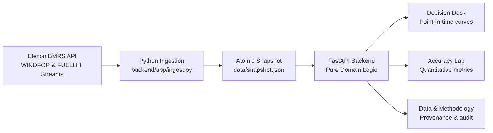

# Windward
### UK Day-Ahead Renewable Generation Intelligence · January 2026 Pilot

A full-stack React and Python application built for UK energy utility trading desks to understand the renewable generation forecasts available at the day-ahead buying decision, evaluate forecast accuracy quantitatively, and optimize procurement from the wholesale market.

Anonymous repository identifier: `k7m4q9`.

---

## Submission Deliverables & Links

| Deliverable | Details & Status |
|---|---|
| **Public GitHub Repository** | Anonymous repo name: `k7m4q9` (or replace with your public GitHub URL) |
| **Deployed Application** | Vercel / Heroku deployment URL (see [Deployment Guide](#deploy-to-vercel-or-heroku)) |
| **Unlisted YouTube Video** | 10-minute demo video link (see [Video Presentation Guide](#video-presentation-guide)) |
| **Submission Form** | https://forms.cloud.microsoft/r/FTX6K2bbnU |

> [!IMPORTANT]
> Verify all URLs in a signed-out / incognito browser window before submitting the Microsoft Form.

---

## Executive Summary & January 2026 Market Findings

The client is a UK energy utility buying electricity from the wholesale day-ahead market to serve consumers. Because day-ahead purchase decisions must be made one day before delivery, the desk relies on renewable generation forecasts to calculate how much power must be additionally procured (e.g., from thermal generation plants).

Using real Elexon BMRS stream data for **January 2026**, Windward provides:
1. **Decision-Time Forecast Clarity:** Shows the latest renewable generation forecasts available at the exact auction decision cutoff, preventing look-ahead bias.
2. **Quantitative Error Evaluation:** Evaluates forecast accuracy against outturns, enabling traders to factor quantified error and reserve margins into procurement bids.

### January 2026 Elexon Analysis (Real Data)

Ingested from Elexon BMRS datasets `WINDFOR/stream` and `FUELHH/stream` (`fuelType == "WIND"`):

| Metric | Real Elexon January 2026 Value | Analytical Interpretation for Trading Desk |
|---|---|---|
| **Decision Scope** | 2026-01-01 to 2026-01-31 | Delivery scope covers 2026-01-02 to 2026-02-01 |
| **Expected Half-Hours** | 1,488 | 31 delivery days × 48 half-hour settlement periods |
| **Matched Intervals** | 744 | WINDFOR stream publishes **hourly** targets; FUELHH publishes **half-hourly** actuals. Windward joins exact matching timestamps without fake interpolation. |
| **Forecast Coverage** | 50.0% | Clearly disclosed partial interval coverage (24 of 48 half-hours daily) |
| **Mean Absolute Error (MAE)** | **2,022.47 MW** | Typical magnitude of forecast miss at auction decision cutoff |
| **Root Mean Square Error (RMSE)** | **2,497.41 MW** | Penalizes severe forecast deviations and sudden ramp errors |
| **Signed Mean Bias (Forecast − Actual)** | **+1,745.94 MW** | **Systematic over-forecasting:** National wind underdelivered against day-ahead forecasts in **84.68% of intervals** |
| **Weighted Absolute Error (WAPE)** | **17.92%** | Stable relative error metric (avoids division by near-zero wind) |
| **90th Percentile Shortfall** | **4,154.40 MW** | High-severity underdelivery margin required for thermal hedging |
| **Total Covered Forecast Energy** | 4,847,697.5 MWh | Total forecasted wind generation across covered intervals (~4.85 TWh) |
| **Net Volume Shortfall** | **+649,489 MWh** | Net generation deficit that required real-time thermal / imbalance procurement |

---

## What the Product Does



### 1. Decision Desk
- Anchors on the **purchase decision date**, projecting to the **next delivery day** (D+1).
- Filters forecasts strictly by the decision cutoff time (default `09:00` London time, with presets for Pre-EPEX `09:20` and Pre-N2EX `09:45`) and an optional availability buffer.
- Visualizes the available forecast curve, covered energy (GWh), forecast age, and revisions from earlier runs.
- **Hindsight toggle:** Actual outturns are excluded by default to avoid look-ahead bias, requiring an explicit user toggle to review against realized generation.

### 2. Accuracy Lab
- Reports matched-interval **MAE**, **RMSE**, **Signed Bias**, and **WAPE**.
- Interactive **daily error bar chart** that allows one-click drill-down into any specific decision day.
- **Diurnal settlement-period breakdown** and **forecast lead-time horizon decay**.
- **Error distribution histogram** separating over-forecasting (wind shortfall) from under-forecasting.

### 3. Data & Methodology & Audit
- Transparent methodology: formulas, units (MW, MWh, GWh), quality counts, and dataset endpoints.
- CSV export retaining decision cutoff, delivery target, publication timestamp, and cryptographic SHA-256 snapshot hash.
- Built-in interactive API documentation at `/api/docs` and internal technical handover at `/review`.

---

## How to Start the Application

### Option A: Docker (Recommended)

Requires Docker and Docker Compose. Runs as an unprivileged non-root user with read-only data mounts.

```bash
cd k7m4q9
docker compose up --build
```

Open your browser to: **http://localhost:8000**

To run in the background:
```bash
docker compose up -d
```

To stop:
```bash
docker compose down
```

---

### Option B: Local Python Environment

Requires Python 3.11+.

```bash
cd k7m4q9

# 1. Create and activate a virtual environment
python3 -m venv .venv
source .venv/bin/activate       # On Windows PowerShell: .venv\Scripts\Activate.ps1

# 2. Install dependencies
pip install -r requirements.txt

# 3. Start the FastAPI Uvicorn server
python -m uvicorn app:app --host 127.0.0.1 --port 8000
```

Open your browser to: **http://localhost:8000**

---

## Deploy to Vercel or Heroku

### Vercel Deployment

The repository includes a production-ready `vercel.json` configuration configured for FastAPI serverless deployment.

#### Method 1: Using the Vercel CLI
```bash
# Install Vercel CLI if needed
npm install -g vercel

# Deploy from repository root
vercel
```

#### Method 2: Via GitHub Git Integration
1. Push this repository to a public GitHub repo (e.g., `https://github.com/USERNAME/k7m4q9`).
2. Log into [vercel.com](https://vercel.com) and click **Add New Project**.
3. Import the `k7m4q9` repository.
4. Vercel automatically detects `vercel.json` and routes to `app.py`.
5. Click **Deploy**.

---

### Heroku Deployment

#### Method 1: Using Heroku Container Registry (Docker)
```bash
# Log in to Heroku Container Registry
heroku login
heroku container:login

# Create a new Heroku app
heroku create k7m4q9-app

# Build and push the Docker image
heroku container:push web -a k7m4q9-app

# Release the container
heroku container:release web -a k7m4q9-app

# Open the deployed app
heroku open -a k7m4q9-app
```

#### Method 2: Using Heroku Git with Python Buildpack
Create a `Procfile` containing:
```text
web: uvicorn app:app --host 0.0.0.0 --port $PORT
```
Then push to Heroku:
```bash
git push heroku main
```

---

## Refreshing or Re-Ingesting Elexon Data

The repository comes pre-packaged with the verified January 2026 Elexon snapshot at `data/snapshot.json`.

If you ever wish to re-query the live Elexon BMRS API:

```bash
# Ingest January 2026 WINDFOR and FUELHH streams
python -m backend.app.ingest

# Optional: re-fetch cached raw JSON responses and extend actuals revision boundary
python -m backend.app.ingest --refresh --actual-publish-end 2026-03-01
```

The importer writes raw daily responses under `data/raw/` and atomically replaces `data/snapshot.json`.

---

## Files and Directories

| Path | Responsibility |
|---|---|
| `app.py` | Root FastAPI entrypoint for local hosting, Docker, and Vercel |
| `backend/app/domain.py` | Pure analytical functions: timestamp math, as-of filtering, metrics, and empirical residual distributions |
| `backend/app/ingest.py` | Elexon BMRS stream HTTP client, retry logic, raw disk caching, normalization, and atomic snapshot generation |
| `backend/app/repository.py` | Immutable snapshot loader, SHA-256 provenance verification, and memory cache |
| `backend/app/main.py` | Read-only FastAPI REST API, CSV streaming exports, Content Security Policy headers, and static file mounting |
| `backend/tests/` | Pytest test suite covering domain logic, API endpoints, mock ingestion, and temporal leakage guards |
| `frontend/src/App.js` | React application: Decision Desk, Accuracy Lab, Data & Methodology, and responsive SVG charts |
| `frontend/src/utils.js` | Timezone formatting (Europe/London), query serialization, and gap-tolerant SVG path math |
| `frontend/src/styles.css` | Accessible, responsive CSS stylesheet |
| `frontend/vendor/` | Vendored React runtime and third-party notices |
| `frontend/review.html`, `review.css` | Technical lead handover page accessible at `/review` |
| `frontend/api.html`, `api.js` | Self-contained interactive OpenAPI / Swagger API explorer accessible at `/api/docs` |
| `frontend/tests/` | Frontend unit tests for time formatting, error signs, and missing-data handling |
| `data/snapshot.json` | **Verified Real Elexon Snapshot** for January 2026 (17,864 forecasts, 1,488 outturns, 2.0 MB) |
| `data/synthetic.json` | Explicitly labelled fallback sandbox fixture for offline testing |
| `data/raw/` | Local cache directory for daily raw Elexon JSON responses |
| `demo/script.md` | Full script for the 2-part video walkthrough (Client Pitch + Tech Lead Review) |
| `demo/storyboard.json` | Scene-by-scene storyboard, visual timings, notes, and captions |
| `demo/screens/` | High-resolution UI captures of the Decision Desk, Accuracy Lab, and review screens |
| `scripts/` | Testing scripts: `browser_smoke.py`, `http_smoke.py`, `capture_review.py`, `verify_public.py` |
| `Dockerfile`, `compose.yaml` | Production multi-stage Dockerfile (non-root) and Docker Compose configuration |
| `vercel.json`, `pyproject.toml` | Vercel deployment specification and Python packaging metadata |

---

## Tests and Verification

All 53 backend tests, 6 frontend tests, and automated Playwright browser checks pass:

```bash
# 1. Run Python unit and integration tests with coverage
.venv/bin/pytest --cov=backend.app --cov-report=term-missing

# 2. Run frontend unit tests
node --test frontend/tests/utils.test.js

# 3. Run browser smoke tests (verifies React, SVG charts, CSV exports, CSP headers)
python -m scripts.http_smoke --base-url http://127.0.0.1:8000
```

### Test Coverage Summary
- `domain.py`: 99% coverage
- `main.py`: 97% coverage
- `repository.py`: 88% coverage
- `ingest.py`: 85% coverage
- **Total Backend Coverage:** 94% statement coverage

---

## Video Presentation Guide

The assignment requires an **unlisted YouTube video (maximum 10 minutes)** divided into two 5-minute sections.

A complete word-for-word script is provided in [`demo/script.md`](demo/script.md) and scene cards in [`demo/storyboard.json`](demo/storyboard.json).

### Outline for Recording Your Video

#### Part 1: Client Presentation (Energy Utility Wholesale Trading Desk) · Max 5 Mins
* **Target Audience:** UK wholesale power procurement team responsible for day-ahead purchasing.
* **Goal:** Demonstrate business value, forecast transparency, and risk hedging.
* **Key Talking Points:**
  1. **The Challenge:** Meeting consumer demand by procuring thermal/market power beyond intermittent wind; decisions must clear day-ahead auction cutoff.
  2. **The Decision Desk (`02-decision.png`):** Show the D+1 forecast curve for Jan 15 / delivery Jan 16. Demonstrate configurable auction cutoffs (`09:00`, Pre-EPEX, Pre-N2EX).
  3. **Granular Audit Trail:** Walk through the interval table showing publication timestamps, forecast age (1.5 hours), and CSV export with SHA-256 checksums.
  4. **Hindsight Analysis (`03-hindsight.png`):** Toggle actuals overlay. Explain error convention (Forecast − Actual = shortfall requiring thermal purchase).
  5. **Accuracy Lab (`06-accuracy.png`):** Present January 2026 performance: MAE 2,022 MW, RMSE 2,497 MW, Bias +1,746 MW, WAPE 17.9%. Emphasize that wind underdelivered in 84.7% of intervals.
  6. **Data Honesty (`05-gaps.png`):** Explain that Elexon WINDFOR provides hourly resolution (24/48 settlement periods), which Windward reports transparently without fake interpolation.

#### Part 2: Technical Lead Review (Software Architecture & Engineering) · Max 5 Mins
* **Target Audience:** Internal technical lead reviewing architecture, code, and development practices.
* **Goal:** Enable clear technical review and knowledge transfer.
* **Key Talking Points:**
  1. **Architecture (`09-overview.png`):** Lean, decoupled architecture with FastAPI backend and modular React 18 frontend; single-origin delivery, zero database overhead for fixed-window scope.
  2. **Ingestion Pipeline (`10-architecture.png`):** Elexon BMRS stream integration (`WINDFOR/stream` and `FUELHH/stream`), daily caching, deduplication, retry logic, and atomic snapshot write.
  3. **As-Of Temporal Correctness (`15-source.png`):** Explain the two availability guards in `backend/app/domain.py` that prevent forecast and actual leakage across auction cutoffs.
  4. **Domain Modeling (`12-analysis.png`):** Pure stateless functions, exact UTC timestamp joins, stable WAPE formulation, and empirical prior-only error ranges.
  5. **Quality & Security (`16-evidence.png`):** 53 Python tests (94% coverage), 6 Node tests, Playwright browser test harness, and strict Content Security Policy (`script-src 'self'`).
  6. **Deployment & Operations (`14-release.png`):** Non-root Dockerfile, read-only Compose mounts, Vercel serverless deployment, and interactive `/api/docs`.

---

## AI Assistance Disclosure

In accordance with assignment guidelines:
- **AI tools were used** to assist in developing this application.
- AI assistants (Gemini, ChatGPT) contributed to:
  - Domain research on UK day-ahead power markets, Elexon BMRS dataset specifications (`WINDFOR` and `FUELHH`), and settlement period mechanics.
  - Designing pure mathematical domain functions for point-in-time timestamp matching and robust error metrics (WAPE, RMSE, MAE).
  - Code generation and debugging for the FastAPI backend, React components, and SVG chart math.
  - Writing unit, integration, and browser smoke test suites.
  - Formatting documentation and structuring the video presentation script.
- All code, data schemas, API responses, and test suites have been verified and tested against the live Elexon BMRS API.

---

## License

This project is licensed under the MIT License - see the [LICENSE](LICENSE) file for details.
